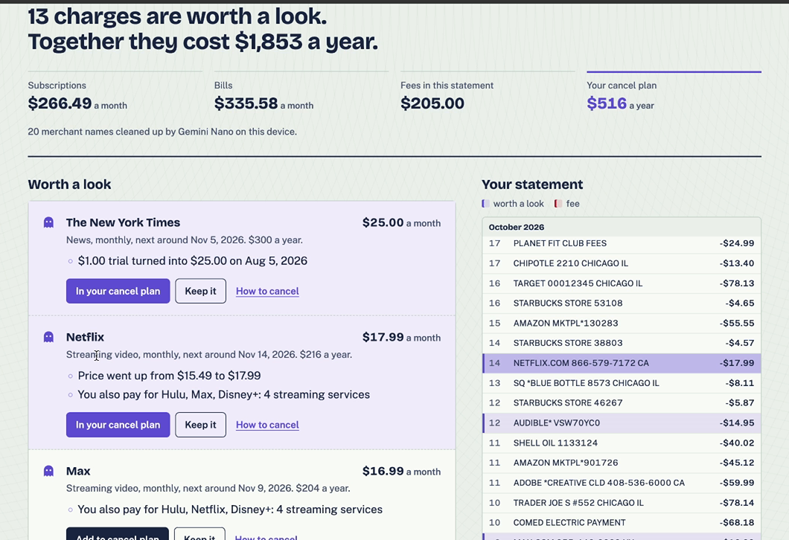
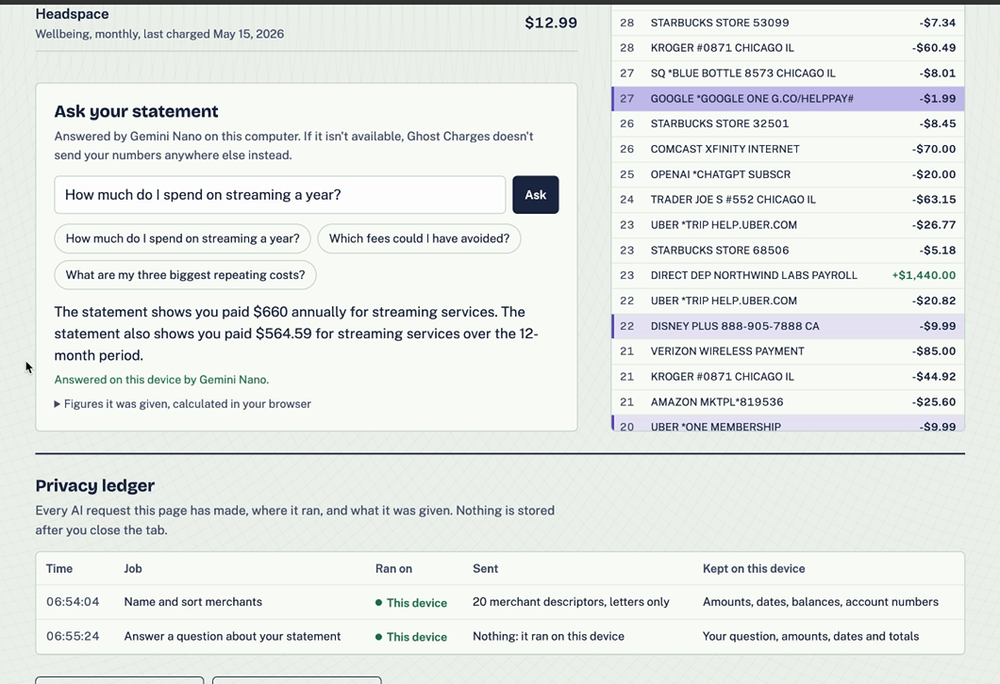
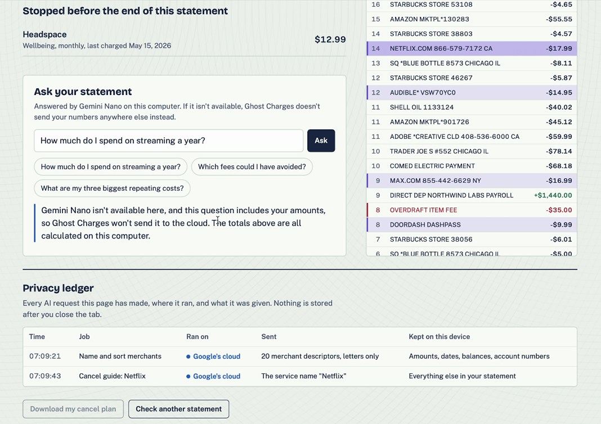
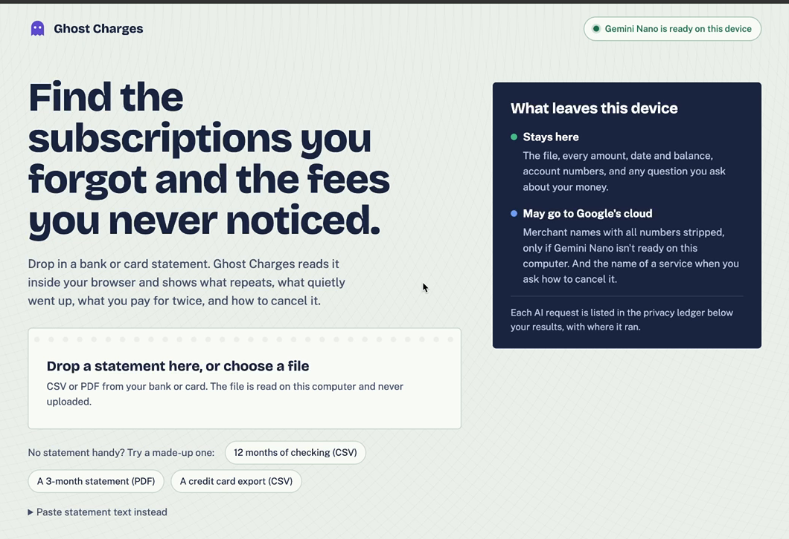
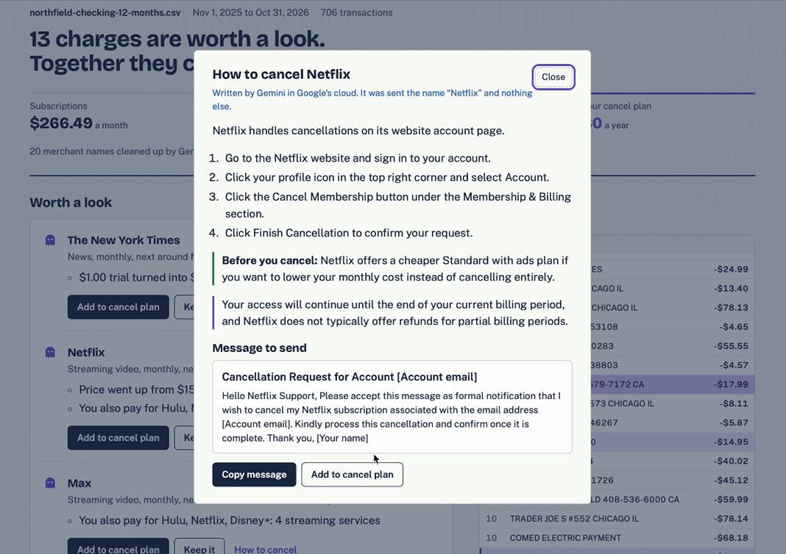

# Ghost Charges

**Find the subscriptions you forgot and the fees you never noticed, without your bank statement leaving your device.**

- **Live app:** https://ghost-charges.web.app (three made-up sample statements built in)
- **Demo video (1:53):** https://youtu.be/oVpS6ZscXf4



Drop in a bank or card statement (CSV or PDF). Ghost Charges reads it in the browser and shows:

- what repeats and what it costs per month and per year;
- what quietly went up;
- what you pay for twice (four streaming services, two music apps, or the same charge twice in a day);
- which free trials turned paid;
- which yearly renewal is about to hit;
- every fee: overdraft, monthly account fees, ATM, foreign transaction and interest.

For anything you want gone, it writes the cancellation steps and a message to send.

Built for Firebase's #BuildHybridAI 2026 with **Firebase AI Logic hybrid inference**: Gemini Nano in Chrome when it is ready, Gemini in the cloud when it isn't, and a hard rule about which data is allowed to take which path.

## Why hybrid, and why this split

A bank statement is about the most private file people have, so "upload it to an AI" is a non-starter. But a small on-device model can't know how to cancel every service on earth. Ghost Charges uses **three models with three different routing choices**, chosen by what each prompt contains:

| Job | Inference mode | What the prompt contains | Why |
|---|---|---|---|
| Clean up merchant names and sort them (`"SQ *BLUE BOTTLE 8573"` → Blue Bottle Coffee, Coffee, one-off) | `PREFER_ON_DEVICE` | Merchant descriptors with **every digit and symbol removed** | Runs on Gemini Nano when it's ready. If it isn't, falling back to the cloud is safe *by construction*: there are no amounts, dates or account numbers in the prompt to leak. |
| Cancel guide for one service | `PREFER_IN_CLOUD` | One service name | This needs world knowledge, which the cloud model has. Offline, it falls back to Gemini Nano. |
| "Ask your statement" (questions about your money) | `ONLY_ON_DEVICE` | Amounts, dates, totals | Never allowed to fall back. If Gemini Nano isn't available, the app says so and sends nothing. |

The rule is enforced in code, not just in copy. Every prompt that *could* run in the cloud passes through `assertCloudSafe()` (`src/prompts.js`), which throws if it finds:
- a currency symbol;
- a decimal amount;
- a run of three or more digits;
- a date.

The test suite checks the guard against the real 12-month sample.

**The privacy ledger** at the bottom of the results lists every AI request the page made:
- the job;
- where it actually ran, taken from Firebase AI Logic's `inferenceSource` (`ON_DEVICE` or `IN_CLOUD`);
- what it was sent;
- what stayed behind.

## How it finds things

All money maths is deterministic JavaScript in `src/detect.js`, never a language model:

1. **Parse.**
   - **CSV:** the parser finds the header even under a title block. It handles separate debit and credit columns, and card exports where purchases are positive.
   - **PDF:** text lines are extracted with pdf.js in the browser.
   - **Pasted text** also works.
2. **Group** charges by a stable merchant key. Reference numbers, card prefixes (`SQ *`, `TST*`, `POS`), phone numbers and state codes are removed. About 60 well-known subscription services are matched by name.
3. **Find the rhythm.** Weekly, every two weeks, monthly, quarterly or yearly, from the median gap between charges. It needs stable amounts or a known subscription service, so a weekly coffee isn't a "subscription". Zelle, Venmo and transfers never count.
4. **Flag what's worth a look:**
   - price rises;
   - trials that turned paid, including $0.00 sign-ups;
   - double billing (same amount within 3 days);
   - overlapping services (4 streaming, 2 music, 2 storage, 2 delivery memberships);
   - yearly renewals due within 30 days of the statement's end.
5. **Fees** are matched by type, each with a short note on how people usually avoid it.
6. **Refine.** The merchant-naming model's answers (`name`, `category`, `kind`) feed back in: unknown monthly payments become *bills* or *subscriptions*, and one-offs are dropped. The report re-renders.

## What it looks like

| Chrome, Gemini Nano on the device | Safari, no on-device model |
|---|---|
|  |  |
|  |  |

## Ask your statement: the model never does sums

"Ask your statement" never lets the model do sums. `src/facts.js` turns the report into short, finished sentences with every total already worked out ("Together that is $54.96 a month, or $660 a year"). For each question, it picks only the few sentences that match, so Gemini Nano gets two to seven lines instead of the whole statement and only has to put them into words. Under each answer, **Figures it was given** shows exactly those lines. Small models are bad at adding up and at picking rows out of long lists; the browser isn't.

The answer is then checked: every dollar amount Gemini Nano writes must be one of the figures it was given (rounding to whole dollars is allowed). If one isn't, the app asks once more, telling the model which amount was wrong. If the second answer still fails, it shows the figures themselves instead of the answer. `unsupportedAmounts()` in `src/facts.js` does the check, and the tests run it on a real answer where Nano swapped two fee amounts.

## Try it

The live app has three made-up statements, with a fictional person and bank:
- 12 months of checking (CSV);
- a 3-month PDF statement;
- a credit card export.

They contain every pattern above.

On-device AI needs Chrome on desktop. Gemini Nano downloads once, from the **Set up on-device AI** button in the top bar. Without it, merchant names are cleaned in the cloud (letters only), and "Ask your statement" stays off by design.

## Run it locally

```bash
npm install
npm test             # parsing, detection, privacy guard (node:test)
npm run dev:mock     # http://localhost:5173 with a stand-in AI, no Firebase project needed
```

`npm run dev:mock` loads `src/dev-ai.js`, a clearly labelled stand-in for the three models so the interface can be worked on without a Firebase project. It is never part of the deployed build.

## Deploy your own (Firebase)

1. Create a Firebase project.
   - In **AI Logic**, choose **Get started** with the Gemini Developer API.
   - Add a **web app** with Firebase Hosting.
2. **App Check:**
   - Create a Fraud Defense (reCAPTCHA Enterprise) website key for your hosting domains.
   - Register the web app in App Check with that key.
   - Turn on enforcement for AI Logic.
   - Put the site key in `public/app-settings.json` as `recaptchaSiteKey`. A site key is public by design.
3. Set your project in `.firebaserc` and run `npm run deploy`.

On Firebase Hosting the app reads its Firebase config from `/__/firebase/init.json`, so no keys are committed to the repo. For local development with a real project, save the web app config as `public/firebase-config.local.json` (git-ignored). Then register the App Check debug token printed in the console.

## Where Firebase AI Logic is used

- `src/ai.js`:
  - `getAI` with `GoogleAIBackend`;
  - three `getGenerativeModel` calls with `InferenceMode.PREFER_ON_DEVICE`, `PREFER_IN_CLOUD` and `ONLY_ON_DEVICE`;
  - `onDeviceParams`: Chrome Prompt API session options, a system prompt, and a JSON-schema `responseConstraint`;
  - `inCloudParams`: system instruction and `responseJsonSchema`;
  - `initializeDeviceModel` with download progress;
  - `generateContent` and `generateContentStream`;
  - `response.inferenceSource` for the ledger.
- App Check with `ReCaptchaEnterpriseProvider` (Fraud Defense), plus Firebase Hosting.

## Data handling

- The statement file is read in memory and never uploaded. Reloading the page, closing the tab or **Check another statement** discards it.
- Amounts, dates, balances and account numbers never enter a prompt that can leave the device. The test `privacy guard` checks this.
- Nothing is stored: no database, no analytics, no cookies, no local storage. The cancel plan download is a text file made in the browser.
- Fonts and the PDF reader are served from the app itself, with no third-party requests other than Firebase and reCAPTCHA.
- This is a tool for reading your own statement. It isn't financial advice, and it never asks for bank logins.

## Limits

- Recurring charges need at least two occurrences to be detected. A yearly subscription seen once is labelled "probably yearly" only when it's a known service.
- PDF parsing expects one transaction per line (date, description, amount). Unusual layouts may need a CSV export instead.
- Gemini Nano availability depends on Chrome version, hardware and disk space; the top bar shows the current state.

## Tech

Vanilla JavaScript, esbuild, Firebase JS SDK 13 (AI Logic, App Check, Hosting), pdf.js, Public Sans and Bricolage Grotesque (self-hosted), `node:test`.

An AI coding assistant (Claude by Anthropic) helped write the code, tests and documentation. Product decisions and the privacy rules were set and reviewed by the author.

## License

Apache License 2.0. See `LICENSE` and `NOTICE`.
